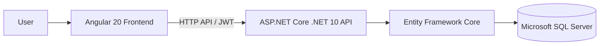

# BizOps — Business Operations Platform

<p align="center">
  <strong>A full-stack business operations and ERP-style platform</strong><br/>
  Sales · Purchases · Inventory · Finance · Reporting · Administration
</p>

<p align="center">
  
  
  
  
  
</p>

## Overview

BizOps brings core business workflows into one workspace, including sales, purchases, inventory, financial records, reporting, and administration.

> **Project status:** Active development baseline. Feature availability and deployment configuration must be verified against the current source before production use.

## Key capabilities

- JWT authentication, refresh-token rotation, password recovery, MFA, account lockout, and role-based access
- Administrator, manager, and staff roles
- Customer and supplier management with transaction histories and balances
- Product catalog, barcode support, CSV imports, stock adjustments, and inventory movements
- Sales invoices, purchase orders, returns, refunds, payments, and expenses
- Dashboards, financial reports, CSV exports, and printable PDF documents
- Company settings, configurable currency, tax, and invoice numbering
- Audit trail and tenant-scoped business data
- AI assistant with stored conversation history
- Accounting workflows including journals, chart of accounts, ledgers, trial balance, and balance sheet
- Database backup and guarded restore workflows

## Architecture at a glance

The repository separates the Angular client from the ASP.NET Core API. The API uses Entity Framework Core to access SQL Server.



## Technology stack

| Layer | Technology |
| --- | --- |
| Frontend | Angular 20, TypeScript, RxJS, SCSS |
| Backend | .NET 10, ASP.NET Core Web API |
| Data access | Entity Framework Core |
| Database | Microsoft SQL Server |
| Security | ASP.NET Core Identity, JWT bearer authentication |
| Validation and logging | FluentValidation, Serilog |

## Repository layout

```text
.
├── frontend/
│   └── business-operations-ui/        # Angular application
├── backend/
│   ├── BusinessOperations.API/        # ASP.NET Core API
│   ├── BusinessOperations.API.Tests/  # Backend tests
│   ├── BusinessOperations.sln
│   ├── DATABASE-RECOVERY.md
│   └── DEEPSEEK_SETUP.md
├── artifacts/
├── DEPLOYMENT.md
└── README.md
```

## Prerequisites

- .NET 10 SDK
- Node.js and npm compatible with the Angular workspace
- SQL Server, SQL Server Express, or LocalDB for local development

## Local development

### 1. Configure the database

Set `ConnectionStrings:DefaultConnection` in the development configuration:

```text
backend/BusinessOperations.API/appsettings.Development.json
```

Apply migrations:

```powershell
cd backend/BusinessOperations.API
dotnet ef database update
```

If the EF Core CLI is not installed:

```powershell
dotnet tool install --global dotnet-ef --version 10.*
```

### 2. Start the API

```powershell
cd backend/BusinessOperations.API
dotnet run --urls http://localhost:5000
```

Swagger: [http://localhost:5000/swagger](http://localhost:5000/swagger)

### 3. Start the Angular application

```powershell
cd frontend/business-operations-ui
npm install
npm start
```

Frontend: [http://localhost:4200](http://localhost:4200)

The Angular development build is configured to call the local API. For production, route `/api` through the web server to the backend as described in [DEPLOYMENT.md](DEPLOYMENT.md).

## Verification

Run backend checks:

```powershell
cd backend
dotnet test BusinessOperations.sln --configuration Release
dotnet build BusinessOperations.sln --configuration Release
```

Run frontend checks:

```powershell
cd frontend/business-operations-ui
npm install
npx tsc -p tsconfig.app.json --noEmit
npm run test:ci
npm run build -- --configuration production
```

These commands are provided as a verification workflow; their success has not been independently confirmed in this documentation update.

## Security and configuration

Never commit database passwords, JWT signing keys, SMTP credentials, administrator bootstrap passwords, API keys, or customer data. Use environment variables or a hosting platform's secret manager.

The previously published default administrator password was removed from this public documentation. Inspect the local development seed/configuration to understand account provisioning. Use unique local-only credentials, and rotate any credential that may have been used on a reachable system.

## Deployment and recovery

- [Production deployment guide](DEPLOYMENT.md)
- [Database recovery guide](backend/DATABASE-RECOVERY.md)
- [AI provider setup notes](backend/DEEPSEEK_SETUP.md)

## License

The existing project documentation describes this software as proprietary. No open-source license is granted by this README; contact the repository owner for usage permissions.
